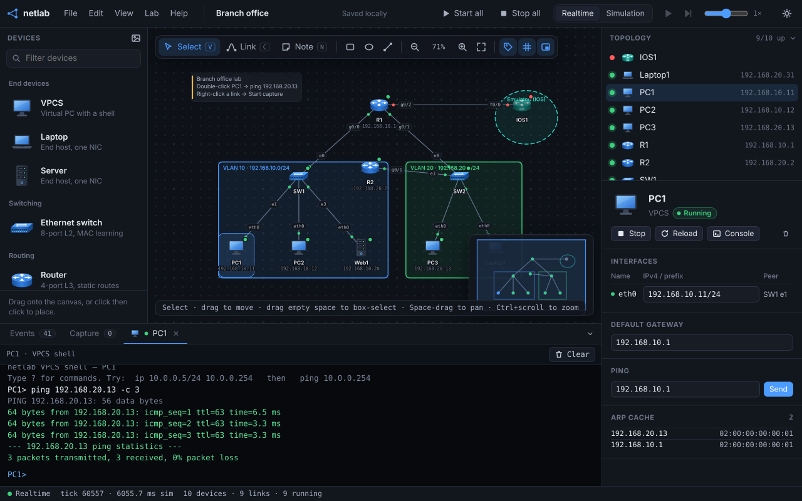

# netlab

**netlab** is a zero-backend network simulation and emulation lab that runs entirely in the browser. It combines a deterministic **Rust → WebAssembly** L2/L3 switching and routing fabric with real hardware emulation compiled to WebAssembly—booting real **Cisco IOS routers & switches** (`c7200` / `c3725` with `NM-16ESW` 16-port EtherSwitch ASIC) via Dynamips and **MikroTik RouterOS / CRS Switches / Open vSwitch (Linux) / 32-bit x86 VMs** via v86 on the same virtual wire.

No backend server, local daemon, or cloud VM is required. Operating system images, NVRAM configurations, virtual disks, and topologies stay locally in your browser (`IndexedDB` / `localStorage`).

**Live demo:** https://netlab.rixlab.xyz



---

## Features

- **Hybrid Simulated + Emulated Fabric**
  - **Simulated Nodes (`netlab-core` in Rust/WASM):** Instant-boot virtual PCs (VPCS), laptops, servers, L2 learning Ethernet switches (up to 16 ports), and L3 IPv4 routers (up to 8 ports) with ARP, static routing, ICMP, DHCP (client and server), DHCP relay, DNS, HTTP, TCP/UDP probes, source NAT (masquerade), extended ACLs, and a simplified OSPFv2. The simulated switch speaks 802.1Q: every port starts as access VLAN 1, so an existing flood still works, and a tag for any other VLAN is dropped until the port is a trunk.
  - **Real Emulated Routers & Managed Switches (`Dynamips` & `v86` in WASM):**
    - **Cisco 7200 Router (`ios`):** Full Cisco IOS L3 router (`f0/0`–`f6/0` + `f0/1`).
    - **Cisco Switch (`ios-sw`):** Up to 16-port managed L2/L3 switch via Dynamips **`NM-16ESW`** hardware EtherSwitch module (`fa1/0`–`fa1/15` on `c3725`/`c3745`/`c2691` images with hardware 802.1Q VLANs, Trunking, VTP, PVST+/STP, Port-Channel, and L3 SVIs) or **`PA-8E`** bridge groups (`e1/0`–`e2/7` on `c7200` images).
    - **MikroTik RouterOS (`routeros`) & MikroTik CRS Switch (`mikrotik-sw`):** Real RouterOS v6 x86 with 8 Ethernet ports (`ether1`–`ether8`), Bridge VLAN Filtering (`802.1Q` / `802.1ad` QinQ), STP/RSTP/MSTP, LACP (`802.3ad`), OSPF, BGP, VRRP, MPLS, and Firewall/NAT.
    - **Open vSwitch / Linux Switch (`ovs-sw`) & x86 VM (`x86`):** 8-port 32-bit x86 VM (`eth0`–`eth7`) for running Linux with Open vSwitch (`ovs-vsctl`), `iproute2` VLAN-aware bridges, or custom appliances.
    - **FRRouting (`frr`):** 8-port 32-bit Linux router (`eth0`–`eth7`) with a `vtysh` starter script for OSPF, IS-IS, BGP EVPN and BFD.
    - **Firewall (`firewall`):** 8-port perimeter appliance (`wan0`, `dmz0`, `lan0`–`lan5`) with a stateful `nftables` forward-chain starter script.
- **Multi-Ethernet Interface Support**
  - Configure multi-homed hosts, bastion servers, routers, switches, and emulated VMs directly from the Inspector (**`+ Add`** / **`- Remove`** interface buttons).
  - Supports up to **8 NICs** on End Hosts (`eth0`–`eth7`), Routers (`g0/0`–`g0/7`), Cisco 7200 (`f0/0`–`f6/0`, `f0/1`), MikroTik RouterOS & CRS Switch (`ether1`–`ether8`), Open vSwitch & x86 VMs (`eth0`–`eth7`), and up to **16 ports** on Ethernet Switches (`e0`–`e15`) and Cisco Switches (`fa1/0`–`fa1/15`).
- **Topology Template Marketplace (32 Curated Labs · Beginner → Expert)**
  - Press **`T`** (or click **Templates** in the top bar) to browse **32 ready-to-run network topologies** with auto-generated SVG schematics, difficulty tabs (`Beginner`, `Intermediate`, `Advanced`, `Expert`), category & tag filters, and step-by-step lab objectives:
    - **Beginner (6):** Point-to-Point Ethernet, Switched LAN, Single-Router Subnets, Cascaded Switches, SOHO Home Gateway, CIDR/VLSM Subnetting.
    - **Intermediate (11):** Branch Office (Cisco IOS Edge), Multi-Hop WAN Triangle, Multi-Homed DMZ Bastion, Hub-and-Spoke WAN, 5-Hop Traceroute Chain, Metro Fiber Ring, 3-Tier Microservices, Access VLANs and an 802.1Q Trunk, DHCP Relay, Two-Router OSPF, Static NAT and a Port Forward.
    - **Advanced (8):** Campus 3-Tier Hierarchy, Dual-ISP Enterprise Edge, IXP 4-AS Peering Fabric, Industrial ICS/SCADA Purdue Model, Smart Hospital PACS/HL7 Campus, Multi-Region Anycast CDN, **Cisco Switch 802.1Q VLAN Trunking & PVST+**, **MikroTik CRS Bridge VLAN Filtering & RSTP**.
    - **Expert (7):** Leaf-Spine (Clos) Data Center, Multi-Vendor Emulation (Cisco IOS + RouterOS + x86 VM), 4-Region Full-Mesh ($K_4$) Core, Zero-Trust SOC Cyber Range (4-NIC SIEM), Carrier MPLS P/PE Core, AI/GPU Rail-Optimized Training Cluster, **Multi-Vendor Managed Switching Ring (Cisco Switch + MikroTik CRS + Open vSwitch)**.
  - Publish any custom canvas topology to **My Templates** (`localStorage`) or export as `.netlab.json`.
- **Realtime & Step-by-Step Simulation Modes**
  - **Realtime Mode:** Runs the switching/routing fabric at ~1 tick/ms so emulated OS guests experience LAN latency and responsive interactive consoles.
  - **Simulation Mode:** Packet Tracer–style visual packet animation across links with Play/Pause, single-tick stepping (`.`), and adjustable speed (`0.25×` to `4×`).
- **Link quality**
  - Select a cable and set delay, jitter, loss, MTU, and a speed badge (`10M`, `100M`, `1G`, `10G`, `WAN Serial`). `10M`, `100M` and WAN Serial also add serialization delay. The canvas labels a link when it is not a plain 1G cable.
- **Startup scripts**
  - Every node has a plain-text startup script in the inspector (IOS config, MikroTik `.rsc`, or a shell script). **Apply** pastes it into the console. Simulated nodes can apply it on start. IOS NVRAM (`write memory`) stays separate.
- **Built-in Packet Capture & Wireshark Export**
  - Attach a live sniffer to any link. Filter the live list (`stp`, `pvst`, `vlan == 10`, `arp`, `icmp`, `ospf`, `ip == 10.0.0.1`), with row colours for ARP, ICMP, TCP, UDP, DHCP, DNS, STP/PVST+, 802.1Q and routing protocols. Replay a captured frame, inject a crafted Ethernet/VLAN ARP or ICMP frame, or **Follow TCP** to concatenate the payload of the selected 4-tuple in both directions. Inspect frames with a built-in protocol dissector (Ethernet II, **802.1Q VLAN**, **802.1ad QinQ**, **STP / RSTP / PVST+ BPDUs**, **CDP / VTP**, **LLDP**, **LACP**, ARP, IPv4, ICMP, TCP, UDP, DHCP, DNS, HTTP, GRE, OSPF, EIGRP, VRRP), interactive hex dump, and one-click **`.pcap` export** for Wireshark.
- **Interactive Consoles**
  - **Simulated CLI:** Built-in VPCS shell for hosts and a Cisco-like CLI for switches and routers featuring Tab completion, command abbreviation (`sh ip int br`, `sh ip ro`, `sh run`), and contextual `?` help.
  - **Emulated Terminals:** Full `xterm.js` serial console and VGA screen tabs for Cisco IOS, RouterOS, Open vSwitch, and x86 VMs.
- **Diagramming & Portable Labs**
  - Infinite pan/zoom canvas with grid snap, minimap, interface labels, sticky notes, vector shapes (rectangles, ellipses, lines), dark/light theme toggle, PNG diagram export, and portable `.netlab.json` topology files. **File → Save YAML lab…** writes a readable `.netlab.yaml` of the same topology (startup blocks included). **Edit → Undo / Redo** (`Ctrl+Z` / `Ctrl+Y`) restores a topology snapshot and stops running VMs. **Lab → Snapshots…** stores a named copy of the topology plus that moment's IOS NVRAM and VM disks.

---

## Quick Start

### Prerequisites

- [Rust](https://rustup.rs/) and [`wasm-pack`](https://rustwasm.github.io/wasm-pack/installer/) (to build the Rust simulation fabric)
- Python 3 (for the local static HTTP server)
- Docker *(optional — only needed if you want to recompile Dynamips from source; prebuilt `web/dynamips.{js,wasm}` artifacts are included)*

### Build & Run

```sh
# 1. Compile the Rust switching/routing fabric to WebAssembly (outputs to web/pkg/)
make wasm

# 2. Start the local web server on http://localhost:8471
make serve
```

Then open **`http://localhost:8471`** in a modern desktop browser (Chromium, Firefox, or Safari).

### Docker

No Rust toolchain needed — the prebuilt `web/pkg/` artifacts are committed, so the image is just nginx serving `web/` with the COOP/COEP headers already configured:

```sh
docker compose up --build
```

Then open **`http://localhost:8471`**.

> **Why `make serve`?**
> Emulated Cisco IOS uses WebAssembly pthreads backed by `SharedArrayBuffer`, which requires the page to be served in a cross-origin isolated context (`Cross-Origin-Opener-Policy: same-origin` and `Cross-Origin-Embedder-Policy: require-corp`). `web/serve.py` sets these headers automatically, and netlab ships `web/_headers` with the same policy for hosts that honor it (including Cloudflare). On other static hosting (Vercel, Netlify, GitHub Pages + service worker, or Nginx), configure those two HTTP response headers to enable Cisco IOS nodes.

---

## Deploy to Cloudflare

Host your own copy as a Cloudflare Worker serving the static `web/` directory — no build step needed, the prebuilt `web/pkg/` wasm-bindgen output and COOP/COEP `_headers` are committed:

[](https://deploy.workers.cloudflare.com/?url=https://github.com/Alg0rix/netlab)

The button clones the repository into your GitHub account and deploys it to a `<name>.<subdomain>.workers.dev` URL. Or deploy from the command line with [Wrangler](https://developers.cloudflare.com/workers/wrangler/):

```sh
npx wrangler login
npx wrangler deploy
```

To attach a custom domain, add it under `routes` in [`wrangler.jsonc`](wrangler.jsonc) (the zone must be active on your Cloudflare account). `make wasm` is only needed if you modify `core/` or `wasm/`.

---

## Device Catalog & Bring Your Own Image (BYOI)

Nothing proprietary ships with **netlab**. Simulated nodes work out of the box; for emulated nodes, you supply your own images via **Lab → Images…** (or directly in the node inspector). Images are stored locally in your browser's `IndexedDB`.

| Device | Type | Engine | Image Required | Interfaces (Default → Max) |
|---|---|---|---|---|
| **VPCS / Laptop / Server** | Simulated Host | `netlab-core` (Rust/WASM) | None (built-in) | `eth0` → up to `eth7` (8 NICs) |
| **Ethernet Switch** | Simulated L2 Switch | `netlab-core` (Rust/WASM) | None (built-in) | `e0`–`e7` → up to `e15` (16 ports) |
| **Router** | Simulated L3 Router | `netlab-core` (Rust/WASM) | None (built-in) | `g0/0`–`g0/3` → up to `g0/7` (8 ports) |
| **Cisco 7200** | Emulated Router | Dynamips → WASM | `c7200` / `c3725` IOS `.bin` (uncompressed ELF) | `f0/0`–`f3/0` → up to 8 FastEthernet ports |
| **Cisco Switch** | Emulated Managed L2/L3 Switch | Dynamips (`NM-16ESW` / `PA-8E`) → WASM | `c3725` IOS `.bin` (recommended for `NM-16ESW`) or `c7200` IOS `.bin` | `fa1/0`–`fa1/7` → up to `fa1/15` (16 switchports) |
| **MikroTik RouterOS** | Emulated Router | v86 (32-bit x86) | RouterOS **v6** x86 `.iso` or raw `.img` | `ether1`–`ether4` → up to `ether8` (8 NICs) |
| **MikroTik CRS Switch** | Emulated Managed Switch | v86 (32-bit x86) | RouterOS **v6** x86 `.iso` or raw `.img` | `ether1`–`ether8` (8 switchports) |
| **Open vSwitch / Linux** | Emulated Managed Switch | v86 (32-bit x86) | 32-bit Linux `.iso` or raw `.img` (with OVS / `iproute2`) | `eth0`–`eth7` (8 switchports) |
| **FRRouting** | Emulated Router | v86 (32-bit x86) | 32-bit Linux `.iso` or raw `.img` with FRR | `eth0`–`eth7` (8 NICs) |
| **Firewall** | Emulated Security Gateway | v86 (32-bit x86) | 32-bit Linux `.iso` or raw `.img` with nftables or iptables | `wan0`, `dmz0`, `lan0`–`lan5` |
| **x86 VM** | Emulated Host/Appliance | v86 (32-bit x86) | Any 32-bit x86 `.iso` or raw `.img` | `eth0`–`eth1` → up to `eth7` (8 NICs) |

### Emulated Image Notes

- **Cisco 7200 Router & Cisco Switch (`Dynamips`):**
  - Supply an uncompressed `c3725` or `c7200` IOS `.bin` ELF image (if your image is a compressed `.bin`, decompress it first with `unzip -p image.bin > image.unpacked.bin`).
  - **Cisco Switch (`ios-sw`):** Automatically detects the IOS image platform from the ELF header:
    - With a **`c3725` / `c3745` / `c2691`** image (e.g. `c3725-adventerprisek9-mz.124-15.T14.bin`), netlab inserts the **`NM-16ESW`** 16-port hardware EtherSwitch module (`FastEthernet1/0`–`FastEthernet1/15` backed by Dynamips's Broadcom BCM5600 ASIC emulation), giving you full Cisco Catalyst–style CLI (`vlan database`, `switchport mode access/trunk`, `spanning-tree vlan`, `channel-group`, and `interface Vlan<id>`).
    - With a **`c7200`** image, netlab inserts **`PA-8E`** 8-port Ethernet adapters (`Ethernet1/0`–`Ethernet2/7`), supporting IEEE 802.1D Spanning Tree and Integrated Routing and Bridging (`bridge irb`, `bridge 1 protocol ieee`, `bridge-group 1`, `interface BVI1`).
  - NVRAM (`write memory` / `copy running-config startup-config`) is automatically snapshotted to `IndexedDB` on both `c7200` and `c3725` platforms and is embedded inside exported `.netlab.json` lab files.
- **MikroTik RouterOS & MikroTik CRS Switch (`v86`):**
  - **Use RouterOS v6 (32-bit x86)**, e.g., `mikrotik-6.49.18.iso`. MikroTik CHR and RouterOS v7 require a 64-bit CPU (`x86-64`) and cannot boot in `v86`.
  - On first boot from an ISO, open the node's **Screen** tab and install RouterOS onto the node's blank virtual disk (press `a`, `i`, `n`, `y`, then `Enter` to reboot). Subsequent boots run directly from the installed per-node disk and use the **Serial** console tab.
  - On **MikroTik CRS Switch (`mikrotik-sw`)**, all 8 `ether1`–`ether8` interfaces are enabled by default so you can configure `/interface bridge add name=br0 vlan-filtering=yes protocol-mode=rstp`, `/interface bridge port`, `/interface bridge vlan`, and `/interface bonding`.
- **General x86 VMs & Virtual Disks:**
  - Disk images must be **raw** format. Convert `qcow2`, `vmdk`, or `vdi` images beforehand:
    ```sh
    qemu-img convert -O raw input.qcow2 output.img
    ```
  - Each VM's writable disk is persisted to `IndexedDB` ~8 seconds after guest disk writes and on node Stop. Orphans from deleted labs can be cleaned up in **Lab → Images…**.
  - `v86` supports up to 8 PCI `ne2k` Ethernet adapters (`eth0`–`eth7`), each with a deterministic per-node/per-port MAC (`02:6e:00:xx:xx:pp`). Note that RouterOS binds its initial MAC addresses into its disk configuration—cloning an already-installed raw disk across multiple nodes will also clone those MACs unless reset inside the guest.
- **Background Tab Throttling:**
  - Browsers throttle timers in background tabs, which slows down emulated guest traffic while the netlab tab is hidden.

---

## Simulated CLI Reference

Double-click any node on the canvas (or select it and open the **Console** tab in the bottom dock) to access its interactive shell. Both shells support **Tab** completion, command history (`↑`/`↓`), and contextual **`?`** help.

The commands below belong to the browser console. `netlab-core` also contains an IOS-style CLI engine with a full mode ladder, confirmation dialogs, and script paste. See [`docs/cli.md`](docs/cli.md) for its command surface and its unsupported commands.

### End Hosts (`VPCS` / `Laptop` / `Server`)

```text
ip [if] <addr/len> [gw]     Configure IPv4 address on eth0 (or specified ethN) and optional gateway
                            Examples:
                              ip 192.168.10.11/24 192.168.10.1
                              ip eth1 10.0.20.11/24
ip dhcp [if]                DHCP Discover/Request on that link (UDP 67/68) and install the lease
ip dns <ip>                 Resolver for nslookup (DHCP also sets this)
clear ip dns                Forget the resolver
nslookup <name>             Query the resolver
curl <ip> [port]            HTTP GET (default port 80)
nc [-u] <ip> <port>         TCP connect, or a UDP probe with -u
server dhcp|dns|http on|off Toggle a daemon on this host (new Server nodes start with all three on)
server dns a <name> <ip>    Publish an A record
clear ip [if]               Remove the configured IPv4 address on eth0 (or specified ethN)
show ip                     Display IPv4 addresses, gateway, DNS, DHCP state, and MAC addresses
show arp | arp              Display the ARP table
show route                  Display the routing table
ping <ip> [-c <count>]      Send ICMP echo requests
traceroute <ip>             ICMP probes with TTL 1 through 8. A hop prints the router that sent time exceeded
traffic <ip> tcp|udp|icmp <port> -c <n>
                            Send that many probes, spaced like ping
hostname <name>             Rename the host
reload                      Reset dynamic state (ARP cache)
```

### Simulated Switches & Routers

Abbreviations work just like IOS (`sh ip int br`, `sh ip ro`, `sh mac addr`, `sh run`):

```text
show ip interface brief     Summary of interfaces, IPv4 addresses, and link status
show interface              Detailed interface counters and MAC addresses
show ip route               Display connected and static routes (Router)
show ip arp | show arp      Display the ARP cache
show mac address-table      Display learned L2 forwarding table (Switch)
show running-config         Print current node configuration as CLI commands
ip address <if> <addr/len>  Assign an IPv4 address to an interface (Router)
no ip address <if>          Remove an interface's IPv4 address (Router)
ip route <prefix/len> <next-hop> [if]
                            Add a static route (Router)
no ip route <index>         Remove a static route by its index in `show ip route`
ip nat inside|outside <if>  Source NAT. Inside hosts are masqueraded as the outside address.
                            With an outside port and no explicit inside, every other port is inside.
ip nat inside source static <inside-ip>
                            1:1 map. New sessions to the outside interface address go to that inside host,
                            including ping of the router address. One 1:1 map per router.
ip nat inside source static tcp|udp <inside-ip> <inside-port> <outside-port>
                            Static port forward. Does not take over the router's own ICMP.
no ip nat inside source static <inside-ip>
no ip nat inside source static tcp|udp <outside-port>
show ip nat                 NAT role of each interface, plus static maps
no ip nat <if>              Clear a NAT role
ping <ip> [-c <count>]      Send ICMP echo requests from the device
traceroute <ip>             ICMP probes with TTL 1 through 8
traffic <ip> tcp|udp|icmp <port> -c <n>
                            Send that many probes, spaced like ping
hostname <name>             Rename the device
reload                      Clear learned ARP and MAC tables
switchport mode <if> access|trunk
                            Simulated switch only. Default is access VLAN 1
switchport access vlan <vid> <if>
switchport trunk native <vid> <if>
switchport trunk allowed <if> <list>|all
                            Trunks tag every VLAN except the native VLAN
ip access-list <n> permit|deny ip|icmp|tcp|udp <src> <wild> <dst> <wild> [eq <port>]
                            `any` is 0.0.0.0 255.255.255.255. An applied list ends in an implicit deny
ip access-group <n> in|out <if>
no ip access-list <n>       Delete the list and detach it from every port
ip helper-address <if> <server>
                            Relay DHCP Discover/Request. giaddr is this interface
no ip helper-address <if>
router ospf network <prefix> <wild> area <id>
ip ospf <if> area <n>       Simplified OSPFv2 (not the Cisco packet). Hellos stay on the link
no router ospf              Drop adjacencies and O routes
show ip ospf                Router id, networks, neighbors
```

Static routes beat OSPF when the prefix length is the same. A longer OSPF prefix still wins. Connected routes always win. OSPF routes are not written back as `ip route`.

---

## Keyboard Shortcuts

| Key | Action |
|---|---|
| `T` | Open **Topology Template Marketplace** (Beginner → Expert labs) |
| `V` | Select tool |
| `C` | Link (cable) tool |
| `N` | Sticky note tool |
| `R` / `O` / `/` | Draw Rectangle / Ellipse / Line (`Shift` constrains aspect/angle) |
| `Space` + drag | Pan canvas |
| `+` / `-` / `0` | Zoom in / Zoom out / Reset zoom (100%) |
| `F` | Fit topology to view |
| `L` / `G` / `M` | Toggle interface labels / grid snap / minimap |
| `Shift` + `Space` | Play / Pause in Simulation mode |
| `.` | Step forward one simulation tick |
| `` ` `` | Toggle bottom dock (Events, Capture, Consoles) |
| `F2` | Rename selected node |
| `Ctrl/Cmd` + `D` | Duplicate selection |
| `Ctrl/Cmd` + `S` / `O` | Save `.netlab.json` / Open `.netlab.json` or `.netlab.yaml` |
| `Ctrl/Cmd` + `Z` / `Y` | Undo / redo the topology. This stops running VMs |
| `Delete` / `Backspace` | Delete selected items |
| `?` | Show keyboard shortcuts modal |

---

## Architecture & Repository Layout

```text
netlab/
├── core/                  # Pure-Rust network simulation engine (netlab-core)
│   ├── src/
│   │   ├── cli/           # IOS-style CLI engine: grammar, modes, dialogs, scripts (see docs/cli.md)
│   │   ├── device.rs      # Host, Switch, Router, and Ext (emulated bridge) state
│   │   ├── eth.rs         # Real Ethernet II / ARP / IPv4 / ICMP / TCP / UDP wire codec
│   │   ├── services.rs    # DHCP, DNS, HTTP, TCP/UDP probes, source NAT, DHCP relay
│   │   ├── ospf.rs        # Simplified OSPFv2 hellos, router LSA, SPF
│   │   ├── frame.rs       # Internal simulation frame representations
│   │   ├── link.rs        # Point-to-point links, delay, jitter, loss, MTU, speed
│   │   ├── topology.rs    # Tick-driven L2 learning, L3 longest-prefix match, captures
│   │   └── events.rs      # Structured simulation events for UI inspection
│   └── tests/             # Integration tests (ping, L2/L3 forwarding, wire codec)
├── wasm/                  # wasm-bindgen bindings exposing NetLab to JavaScript
├── emu/                   # Dynamips -> WebAssembly port
│   ├── fetch-dynamips.sh  # Clones upstream GNS3/dynamips @ pinned commit + applies patch
│   ├── dynamips.patch     # Emscripten/WASM port patch (wasm NIO, VTTY, callback arity fixes)
│   ├── wasm/nl_bridge.c   # Shared-memory ring buffers for Ethernet frames, console & NVRAM
│   ├── shim/              # Minimal big/little-endian ELF32 loader shim (libelf)
│   └── WASM-PORT.md       # Technical write-up of the Dynamips WebAssembly port
└── web/                   # Zero-build ES module frontend
    ├── main.js            # Canvas topology editor, simulation loop, inspector, marketplace UI
    ├── templates.js       # 32 built-in topology templates (Beginner → Expert) + SVG previewer
    ├── cli.js             # Interactive VPCS & router/switch CLI with Tab/? completion
    ├── capture.js         # Packet dissector, TCP stream follow, hex viewer, libpcap writer
    ├── labyaml.js         # .netlab.yaml emitter and parser for the subset netlab writes
    ├── ios.js             # Cisco 7200 worker manager & NVRAM sync
    ├── ios_worker.js      # Web Worker hosting the modularized Dynamips WASM build
    ├── vm.js              # v86 emulator integration (MikroTik RouterOS & x86 VMs)
    ├── store.js           # IndexedDB for images, NVRAM, VM disks, and named lab snapshots
    └── serve.py           # Local dev server with COOP/COEP headers
```

### Rebuilding Dynamips WASM Artifacts (Optional)

Prebuilt `web/dynamips.js` and `web/dynamips.wasm` are checked into the repository. If you modify `emu/dynamips.patch` or `emu/wasm/nl_bridge.c`, rebuild them with Docker (`emscripten/emsdk:3.1.74`):

```sh
make emu && make emu-artifacts
```

See [`emu/WASM-PORT.md`](emu/WASM-PORT.md) for deep architectural details on how Dynamips' MIPS64 CPU core, VTTY console, NVRAM mmap zone, and `wasm:` NIO driver bridge into the browser.

---

## Running Tests

Run the Rust simulation core test suite (covering L2 learning, L3 static routing, ARP resolution, ICMP, link/power controls, and real Ethernet wire encoding/decoding):

```sh
cargo test -p netlab-core
```

---

## Third-Party Notices

- **Dynamips (`web/dynamips.{js,wasm}`, `emu/`):** Derived from [GNS3/dynamips](https://github.com/GNS3/dynamips) (GPL-2.0). Upstream source is fetched on demand via `emu/fetch-dynamips.sh` and patched with `emu/dynamips.patch`.
- **v86 (`web/v86/`):** Vendored `v86@0.5.472` (BSD-2-Clause) with unmodified `seabios.bin` and `vgabios.bin` (LGPL-3.0). See [`web/v86/NOTICE.md`](web/v86/NOTICE.md).
- **xterm.js (`web/vendor/xterm/`):** Vendored `@xterm/xterm@5.5.0` and `@xterm/addon-fit@0.10.0` (MIT). See [`web/vendor/xterm/LICENSE`](web/vendor/xterm/LICENSE).
